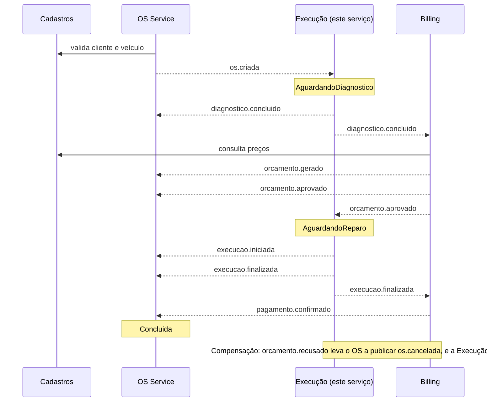
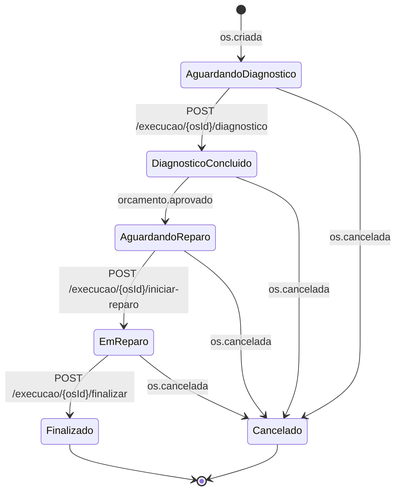

# oficina-execucao-service

Execução Service: um dos quatro microsserviços do Tech Challenge Fase 4 (junto com Cadastros, OS e Billing). Gerencia a fila de execução, o diagnóstico e o reparo das Ordens de Serviço (OS) e participa da Saga da OS por eventos.

| | |
|---|---|
| Stack | .NET 10, ASP.NET Core Minimal APIs, AWS SDK, Serilog, Reqnroll (BDD), Scalar (documentação interativa) |
| Persistência | DynamoDB, tabela única `oficina-execucao-{env}` com GSI por status ([padrões de acesso](docs/access-patterns.md)) |
| Mensageria | SNS e SQS (fila própria com DLQ, tópicos publicados criados por Terraform) |
| Eventos consumidos | `os.criada`, `os.cancelada`, `orcamento.aprovado` |
| Eventos publicados | `diagnostico.concluido`, `execucao.iniciada`, `execucao.finalizada` |
| Deploy | EKS (namespace `oficina`), imagem no GHCR, observabilidade no New Relic |
| API | [docs/openapi.yaml](docs/openapi.yaml) e Scalar UI em `/scalar/v1` |

## Sumário

- [Arquitetura](#arquitetura)
- [Máquina de estados](#máquina-de-estados)
- [Endpoints da API](#endpoints-da-api)
- [Rodando localmente](#rodando-localmente)
- [Testes](#testes)
- [CI/CD](#cicd)
- [Observabilidade](#observabilidade)
- [Infraestrutura (Terraform)](#infraestrutura-terraform)
- [Deploy (Kubernetes)](#deploy-kubernetes)
- [Demos da Saga](#demos-da-saga)
- [Limitações do ambiente](#limitações-do-ambiente)

## Arquitetura

A OS percorre os quatro serviços numa Saga coreografada por eventos (SNS publica, SQS entrega). O OS Service é o orquestrador do estado da OS. O Execução cuida da fila de trabalho do mecânico: recebe a OS, registra o diagnóstico, inicia e finaliza o reparo.



Camadas do projeto (`src/`): `OficinaExecucao.Domain` (entidade `Execucao` e regras de transição), `OficinaExecucao.Application` (casos de uso e portas), `OficinaExecucao.Infrastructure` (DynamoDB, consumidor SQS, publicação SNS, autenticação, observabilidade) e `OficinaExecucao.API` (endpoints e middlewares). Decisões e descobertas do ambiente em [docs/ARCHITECTURE.md](docs/ARCHITECTURE.md).

## Máquina de estados



`Finalizado` e `Cancelado` são finais. Uma transição inválida devolve erro e não altera o estado. O estado `EmDiagnostico` também é aceito como origem do diagnóstico e aparece como filtro de `GET /fila`. Todo evento é processado de forma idempotente (um `os.cancelada` repetido gera uma única transição).

## Endpoints da API

Além de `/health/live` e `/health/ready`, o serviço expõe:

| Endpoint | Descrição |
|---|---|
| `GET /fila` | Lista a fila de execução, opcionalmente filtrada por `status` |
| `POST /execucao/{osId}/diagnostico` | Registra o diagnóstico do mecânico |
| `POST /execucao/{osId}/iniciar-reparo` | Inicia o reparo |
| `POST /execucao/{osId}/finalizar` | Finaliza o reparo |
| `GET /execucao/{osId}` | Estado atual da execução |
| `GET /execucao/{osId}/historico` | Histórico de mudanças de estado |

Todos exigem autenticação: um JWT Bearer válido (`Authorization: Bearer <token>`) ou uma API Key interna (`X-Internal-Api-Key: <chave>`, configurada em `InternalApi:ApiKey`). Em desenvolvimento local, as chaves de `appsettings.json` (`Jwt:SecretKey`, `InternalApi:ApiKey`) já vêm preenchidas com valores de exemplo: não use em produção sem trocá-las via secret real.

## Rodando localmente

Build:

```bash
dotnet build OficinaExecucao.slnx
```

Com Docker:

```bash
docker build -t oficina-execucao-service:local .
docker run -d -p 5000:5000 oficina-execucao-service:local
```

Depois de subir o container:

- Liveness: `GET http://localhost:5000/health/live`
- Readiness (confere a conexão com o DynamoDB): `GET http://localhost:5000/health/ready`
- Documentação interativa (Scalar UI): `http://localhost:5000/scalar/v1`

Para um ambiente local completo (LocalStack com DynamoDB, SNS e SQS, mais a API), use a demo local descrita em [Demos da Saga](#demos-da-saga).

## Testes

| Tipo | Comando | O que prova |
|---|---|---|
| Unidade | `dotnet test tests/OficinaExecucao.Tests.Unit` | Regras de domínio, transições de estado e casos de uso, isolados |
| Integração | `dotnet test tests/OficinaExecucao.Tests.Integration` | Endpoints HTTP reais (autenticação, validação, respostas) com repositório e publicador fakes |
| BDD | `dotnet test tests/OficinaExecucao.Tests.BDD` | Cenários em Gherkin ([Reqnroll](https://reqnroll.net/)) do caminho feliz da fila, do diagnóstico e da finalização, contra os endpoints REST reais |
| E2E (LocalStack) | `dotnet test tests/OficinaExecucao.Tests.E2E` | DynamoDB, SQS e SNS reais num container LocalStack, sem mocks (requer Docker) |
| Tudo, sem E2E | `dotnet test OficinaExecucao.slnx --filter "FullyQualifiedName!~Tests.E2E"` | Atalho local para Unit, Integration e BDD de uma vez, sem Docker. O CI roda `bash scripts/coverage.sh` (Unit + Integration) e depois o projeto BDD |
| Gate de cobertura | `bash scripts/coverage.sh` | Cobertura de linhas de Unit + Integration juntas, mínimo de 80% (falha abaixo disso); relatório em `coverage/report` |
| SonarCloud | automático no CI (PR e push na `main`) | Análise estática e quality gate; roda só se `SONAR_TOKEN`, `SONAR_PROJECT_KEY` e `SONAR_ORGANIZATION` estiverem configurados |
| Demo local | ver [Demos da Saga](#demos-da-saga) | A Execução real participando da Saga, com LocalStack; OS e Billing simulados |
| Demo no EKS | ver [Demos da Saga](#demos-da-saga) | A Execução real no cluster do AWS Academy, com eventos de entrada injetados na fila real |
| Fluxo completo | ver [Demos da Saga](#demos-da-saga) | Uma OS atravessando Cadastros, OS, Execução e Billing reais, até `Concluida` ou até a compensação (`Cancelada`) |

A cobertura exige `dotnet tool install --global dotnet-reportgenerator-globaltool`. Os passos e pré-requisitos das demos estão em [demo/README.md](demo/README.md) e em [docs/fluxo-completo.md](docs/fluxo-completo.md).

## CI/CD

O workflow [.github/workflows/ci.yml](.github/workflows/ci.yml) tem quatro jobs:

| Job | Quando | O que faz |
|---|---|---|
| Build & Test | PR e push na `main` | Restore, testes de unidade e integração com gate de cobertura, testes BDD e SonarCloud (se configurado); publica o relatório de cobertura |
| Build & Push Docker Image | Push na `main`, depois dos testes | Constrói a imagem e publica no GHCR com as tags `sha-<commit>` e `latest` |
| Terraform Validate | PR e push na `main` | `fmt -check`, `init -backend=false` e `validate` em `infra/bootstrap` e nos ambientes |
| Deploy Kubernetes (homolog) | Push na `main`, somente com a variável `DEPLOY_HOMOLOG=true` | Atualiza o pull secret, roda `scripts/deploy.sh homolog` com a imagem recém-publicada e confere se há réplica pronta |

O deploy é opt-in porque as credenciais do AWS Academy expiram em cerca de 4 horas e precisam ser renovadas nos secrets antes de cada uso. Configuração em [docs/deploy.md](docs/deploy.md).

## Observabilidade

O serviço usa o agente .NET do New Relic (APM) e logs JSON com Serilog. Transações HTTP levam o nome da rota (sem o `osId`), o consumo SQS vira transação `OtherTransaction/Message/SQS/<eventType>` e `correlationId` e `osId` acompanham logs e transações. Nomes de transação, atributos e consultas NRQL em [docs/observabilidade.md](docs/observabilidade.md).

## Infraestrutura (Terraform)

A infraestrutura é aplicada em duas etapas, nesta ordem:

1. **`infra/bootstrap`**: provisiona o bucket S3 de state e a tabela DynamoDB de lock usados pelo backend remoto de `infra/terraform/envs/*` (ver `backend.tf` em cada ambiente). Precisa ser aplicado primeiro:

   ```bash
   cd infra/bootstrap
   terraform init
   terraform plan -out=tfplan
   terraform apply tfplan
   ```

2. **`infra/terraform/envs/homolog`** (ou `envs/prod`): provisiona a tabela DynamoDB usada em tempo de execução pelo serviço e a mensageria. Numa conta nova, a primeira passada precisa de `-target` (veja Mensageria abaixo):

   ```bash
   cd infra/terraform/envs/homolog
   terraform init
   terraform plan -out=tfplan
   terraform apply tfplan
   ```

Ambas as etapas exigem credenciais reais do AWS Academy exportadas no ambiente (`AWS_ACCESS_KEY_ID`, `AWS_SECRET_ACCESS_KEY`, `AWS_SESSION_TOKEN`). Este repositório não gerencia essas credenciais: exporte-as antes de rodar `terraform apply`. Os blocos acima salvam o plano com `-out` e aplicam o arquivo salvo.

**Atenção ao aplicar `infra/bootstrap` pela primeira vez:** contas do AWS Academy podem ter uma SCP que nega leitura de object-lock em buckets S3, o que quebra o `apply` do bucket de state logo depois de criado. Ver [docs/ARCHITECTURE.md](docs/ARCHITECTURE.md) para o diagnóstico e o contorno (`terraform untaint` + `terraform apply -refresh=false`).

### Mensageria

O módulo `execucao-messaging` cria a fila SQS, a DLQ e os 3 tópicos SNS que este serviço publica, além de 3 assinaturas SQS para SNS que consomem eventos de outros serviços (`os.criada`, `os.cancelada`, `orcamento.aprovado`). Essas assinaturas leem os ARNs dos tópicos no Parameter Store, e os parâmetros só existem depois que o OS Service e o Billing Service publicarem os próprios tópicos. Enquanto não existirem, um `terraform plan` completo aborta com `ParameterNotFound` e não cria nada. Por isso, numa conta nova, a aplicação tem duas passadas:

1. Primeira passada, só o que independe de outros serviços (tabela, fila, DLQ, tópicos publicados e parâmetros):

   ```bash
   terraform plan -out=tfplan \
     -target=module.execucao_table \
     -target=module.execucao_messaging.aws_sqs_queue.execucao_dlq \
     -target=module.execucao_messaging.aws_sqs_queue.execucao_queue \
     -target=module.execucao_messaging.aws_ssm_parameter.queue_url \
     -target=module.execucao_messaging.aws_sns_topic.published \
     -target=module.execucao_messaging.aws_ssm_parameter.published_topic_arns
   terraform apply tfplan
   ```

2. Segunda passada, depois que OS e Billing aplicarem a mensageria deles: `terraform plan -out=tfplan` e `terraform apply tfplan`, sem `-target`, criam as assinaturas e a policy da fila.

As assinaturas usam `raw_message_delivery = true`: o corpo da mensagem SQS é o envelope do evento diretamente, sem o wrapper de notificação do SNS. A ordem completa entre os serviços está em [docs/fluxo-completo.md](docs/fluxo-completo.md).

**Limitação conhecida:** como o SNS não garante ordem de entrega entre tópicos diferentes, se `os.cancelada` chegar antes de `os.criada` ter sido processado para a mesma OS, o cancelamento é ignorado (logado como warning) e a OS acaba criada depois sem nunca ser cancelada.

## Deploy (Kubernetes)

O serviço roda no cluster EKS compartilhado do grupo (`oficina-infra-k8s`), namespace `oficina`. Manifestos em `k8s/`, scripts em `scripts/deploy.sh` e `scripts/populate-secret.sh`. Passo a passo, acesso do pod à AWS e deploy automatizado em [docs/deploy.md](docs/deploy.md).

## Demos da Saga

| Demo | Alvo | Como roda | Documentação |
|---|---|---|---|
| Local | Docker e LocalStack, na sua máquina | `bash demo/demo-happy-path.sh`, `bash demo/demo-rollback.sh` | [demo/README.md](demo/README.md) |
| EKS | Execução real no cluster do AWS Academy; OS e Billing simulados | `TARGET=eks bash demo/demo-happy-path.sh` | [demo/README.md](demo/README.md) |
| Fluxo completo | Os 4 serviços reais no mesmo cluster | `bash demo/saga-completa.sh happy` ou `rollback` | [docs/fluxo-completo.md](docs/fluxo-completo.md) |

Nas demos local e EKS, API, SNS, SQS e DynamoDB do Execução são reais; OS e Billing são simulados. No fluxo completo nada é simulado: uma OS atravessa os quatro serviços até `Concluida` (caminho feliz) ou `Cancelada` (orçamento recusado). Os arquivos de apoio do fluxo completo (deploys do OS e do Billing adaptados ao Academy e renovação de credenciais) ficam em [demo/academy](demo/academy).

## Limitações do ambiente

Os testes e as demos rodam do jeito que rodam por causa de limites do AWS Academy:

- Não há criação de roles IAM nem IRSA. Os pods usam as credenciais temporárias da sessão (cerca de 4 horas), entregues por um secret do Kubernetes, e o deploy precisa ser refeito a cada renovação do laboratório.
- O cluster tem poucos recursos (um node `t3.small` por padrão). Por isso a demo `eks` mantém só o Execução real e injeta os eventos de entrada, e o fluxo completo exige subir para 2 nodes.
- Os serviços não têm URL pública (só `ClusterIP`): o acesso é por `kubectl port-forward`.
- O RDS é privado e compartilhado entre serviços; o Execução usa DynamoDB e não depende dele.
- Contas do Academy são efêmeras: bucket de state, tabelas e cluster precisam ser recriados a cada sessão, e nomes de bucket S3 são globalmente únicos (ver [docs/ARCHITECTURE.md](docs/ARCHITECTURE.md)).
- O E2E usa LocalStack porque os testes automatizados não podem depender de credenciais que expiram.
